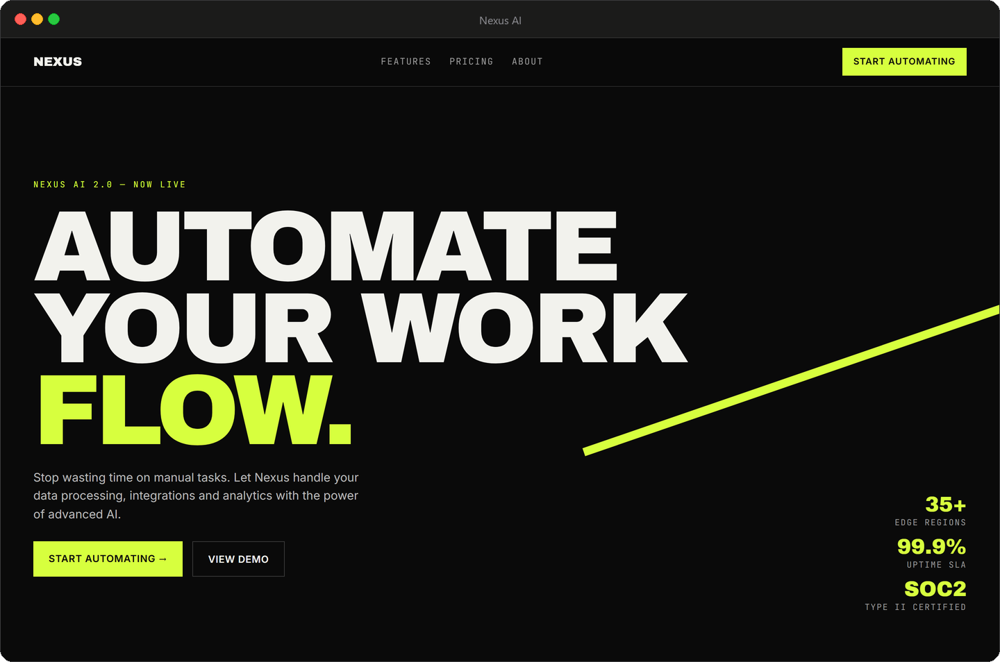

# Nexus AI — Landing Page

A single-page marketing site for a fictional AI product. It was built as a frontend
exercise around scroll-triggered animations, a Bento Grid feature section and a
glassmorphic sticky navbar.

**[Live demo](https://saas-landing-page-rose-zeta.vercel.app)**



## Sections

- **Hero** — headline, primary call to action and product mockup
- **Features** — asymmetric Bento Grid that reflows on mobile
- **Pricing** — three tiers with the middle plan highlighted
- **Footer** — minimal links and copyright

## Stack

React 19 · Vite · Tailwind CSS · Framer Motion · Lucide React

## Run locally

```bash
npm install
npm run dev
```

## Structure

```
src/
├── components/
│   ├── Navbar.jsx             # Sticky glass navbar
│   ├── Hero.jsx
│   ├── Features.jsx           # Bento Grid
│   └── Pricing.jsx
└── App.jsx
```

## Notes

Nexus AI is fictional: the copy, plan names and prices are placeholders. There is no
backend, and the call-to-action buttons do not submit anywhere. The project is best read
as a layout and animation exercise.
